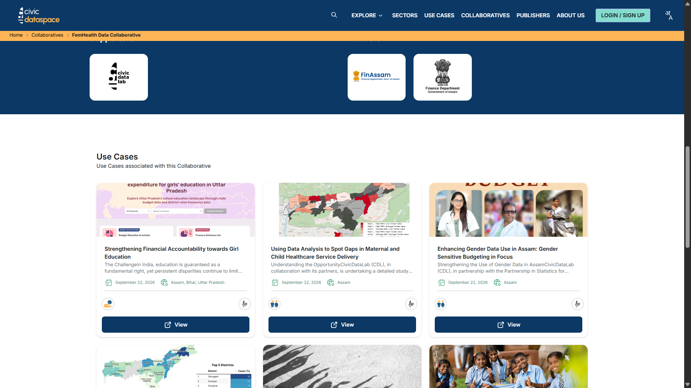
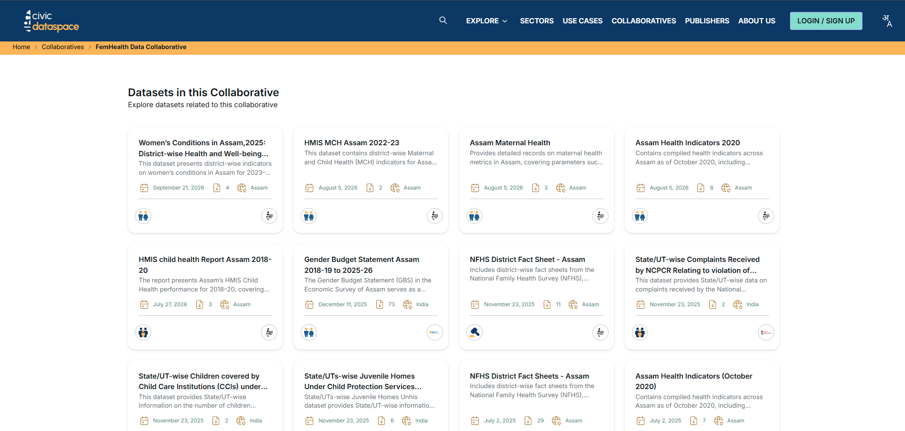

# Navigating the Collaborative

You can open the FemHealth Data Collaborative from CivicDataSpace's listing page for collaboratives: [https://civicdataspace.in/collaboratives/femhealth-data-collaborative](https://civicdataspace.in/collaboratives/femhealth-data-collaborative)

## Platform Overview

**Header & Metrics:** At the top of the page, view thematic tags, an illustration representing the mission, and three live impact metrics: Use Cases, Datasets, and Partner Organisations.

**Problem & Context:** A brief overview outlines the specific policy gaps the collaborative addresses, the datasets included, and the key stakeholders involved.

## Exploring the Platform

1. **Use Cases (Data Storytelling):** Scroll to the Use Cases section and click **View** on any card to explore full analytical dashboards. We recommend starting here to see how data is applied before diving into raw files.
2. **Datasets (Raw Data Downloads):** Scroll down to **Datasets in this Collaborative** to browse underlying data sources. Click any dataset card and select the download icon to retrieve raw files for custom analysis.

